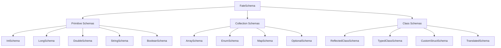

# Schema system

A schema describes how one type becomes bytes. FateWeaver writes the schema into the log ahead of
the data, so a reader can decode the file without knowing anything about your code.

## What are schemas?

Every channel has exactly one schema, and that schema fixes the channel's layout for the life of
the log. It gives you the field names and types a viewer needs, and it makes a type mismatch a
compile error rather than a plot that looks wrong three matches later.

## Schema types overview

FateWeaver provides several categories of schemas:



## Primitive schemas

Five singletons covering the types that need no configuration. Each has a fixed size, so nothing has
to be measured before writing.

### IntSchema

Serializes 32-bit signed integers.

=== "Kotlin"

    ```kotlin
    val encoderPositionChannel = FlightRecorder.createChannel(
        "Motors/Encoder/Position",
        IntSchema.INSTANCE
    )

    encoderPositionChannel.put(motor.currentPosition)
    ```

=== "Java"

    ```java
    FlightLogChannel<Integer> encoderPositionChannel =
        FlightRecorder.createChannel("Motors/Encoder/Position", IntSchema.INSTANCE);

    encoderPositionChannel.put(motor.getCurrentPosition());
    ```

### LongSchema

Serializes 64-bit signed integers, commonly used for timestamps.

=== "Kotlin"

    ```kotlin
    val timestampChannel = FlightRecorder.createChannel(
        "Timestamp",
        LongSchema.INSTANCE
    )

    timestampChannel.put(System.nanoTime())
    ```

=== "Java"

    ```java
    FlightLogChannel<Long> timestampChannel =
        FlightRecorder.createChannel("Timestamp", LongSchema.INSTANCE);

    timestampChannel.put(System.nanoTime());
    ```

### DoubleSchema

Serializes 64-bit floating-point numbers with full precision. `Float` fields and `FloatArray` use
this too, widened on the way out, since the format has no float type. The conversion is exact, but
the encoded value takes 8 bytes rather than 4.

=== "Kotlin"

    ```kotlin
    val voltageChannel = FlightRecorder.createChannel(
        "Battery/Voltage",
        DoubleSchema.INSTANCE
    )

    voltageChannel.put(voltageSensor.voltage)
    ```

=== "Java"

    ```java
    FlightLogChannel<Double> voltageChannel =
        FlightRecorder.createChannel("Battery/Voltage", DoubleSchema.INSTANCE);

    voltageChannel.put(voltageSensor.getVoltage());
    ```

### StringSchema

Serializes UTF-8 strings with length prefixes for efficiency.

=== "Kotlin"

    ```kotlin
    val statusChannel = FlightRecorder.createChannel(
        "Robot/Status",
        StringSchema.INSTANCE
    )

    statusChannel.put("Autonomous Active")
    ```

=== "Java"

    ```java
    FlightLogChannel<String> statusChannel =
        FlightRecorder.createChannel("Robot/Status", StringSchema.INSTANCE);

    statusChannel.put("Autonomous Active");
    ```

### BooleanSchema

Serializes boolean values as single bytes.

=== "Kotlin"

    ```kotlin
    val limitSwitchChannel = FlightRecorder.createChannel(
        "Sensors/LimitSwitch",
        BooleanSchema.INSTANCE
    )

    limitSwitchChannel.put(limitSwitch.isPressed)
    ```

=== "Java"

    ```java
    FlightLogChannel<Boolean> limitSwitchChannel =
        FlightRecorder.createChannel("Sensors/LimitSwitch", BooleanSchema.INSTANCE);

    limitSwitchChannel.put(limitSwitch.isPressed());
    ```

## Collection schemas

### ArraySchema<T>

Handles arrays of any supported type with length prefixes.

=== "Kotlin"

    ```kotlin
    val motorPowersSchema = ArraySchema(DoubleSchema.INSTANCE)
    val motorPowersChannel = FlightRecorder.createChannel(
        "Motors/Powers",
        motorPowersSchema
    )

    motorPowersChannel.put(doubleArrayOf(0.8, 0.6, 0.7, 0.9))
    ```

=== "Java"

    ```java
    ArraySchema<Double> motorPowersSchema = new ArraySchema<>(DoubleSchema.INSTANCE);
    FlightLogChannel<Double[]> motorPowersChannel =
        FlightRecorder.createChannel("Motors/Powers", motorPowersSchema);

    motorPowersChannel.put(new Double[]{0.8, 0.6, 0.7, 0.9});
    ```

!!! tip "Primitive arrays have their own schemas"
    `DoubleArray`, `IntArray`, `LongArray` and `BooleanArray` get `DoubleArraySchema` and friends,
    which write the same bytes as the boxed form with no allocation. You get them automatically
    from `createChannel("Powers", DoubleArray::class.java)`.

### MapSchema<K, V>

Handles maps with an entry count prefix. Keys aren't restricted to strings; any supported type works.

=== "Kotlin"

    ```kotlin
    val powersSchema = MapSchema(StringSchema.INSTANCE, DoubleSchema.INSTANCE)
    val powersChannel = FlightRecorder.createChannel("Motors/Powers", powersSchema)

    powersChannel.put(mapOf("fl" to 0.8, "fr" to 0.6))
    ```

=== "Java"

    ```java
    MapSchema<String, Double> powersSchema =
        new MapSchema<>(StringSchema.INSTANCE, DoubleSchema.INSTANCE);
    FlightLogChannel<Map<String, Double>> powersChannel =
        FlightRecorder.createChannel("Motors/Powers", powersSchema);

    Map<String, Double> powers = new LinkedHashMap<>();
    powers.put("fl", 0.8);
    powers.put("fr", 0.6);
    powersChannel.put(powers);
    ```

!!! warning "Homogeneous values only"
    The format is fixed-shape, so every value in a map must share one type. `Map<String, Any>` cannot
    be logged and is rejected when the schema is built. Entry order is not preserved as meaningful
    information. A nullable value type such as `Map<String, Double?>` is fine and infers an
    `OptionalSchema` for the value.

### EnumSchema<T>

Efficiently serializes enums using ordinal values.

=== "Kotlin"

    ```kotlin
    enum class AllianceColor { RED, BLUE }

    val allianceSchema = EnumSchema(AllianceColor::class.java)
    val allianceChannel = FlightRecorder.createChannel("Match/Alliance", allianceSchema)

    allianceChannel.put(AllianceColor.RED)
    ```

=== "Java"

    ```java
    enum AllianceColor { RED, BLUE }

    EnumSchema<AllianceColor> allianceSchema = new EnumSchema<>(AllianceColor.class);
    FlightLogChannel<AllianceColor> allianceChannel =
        FlightRecorder.createChannel("Match/Alliance", allianceSchema);

    allianceChannel.put(AllianceColor.RED);
    ```

## Class schemas

Four ways to turn one of your own classes into bytes, from zero-effort to full control.

### ReflectedClassSchema<T>

Built by reflecting over the class's public properties. This is what you get when you pass a class
to `createChannel` and say nothing else.

=== "Kotlin"

    ```kotlin
    data class RobotConfig(
        val maxSpeed: Double,
        val wheelDiameter: Double,
        val trackWidth: Double,
        val gearRatio: Double
    )

    // FateWeaver automatically creates a ReflectedClassSchema
    val configChannel = FlightRecorder.createChannel("Robot/Config", RobotConfig::class.java)

    configChannel.put(RobotConfig(1.0, 4.0, 14.5, 1.5))
    ```

=== "Java"

    ```java
    public class RobotConfig {
        public final double maxSpeed;
        public final double wheelDiameter;
        public final double trackWidth;
        public final double gearRatio;

        public RobotConfig(double maxSpeed, double wheelDiameter,
                          double trackWidth, double gearRatio) {
            this.maxSpeed = maxSpeed;
            this.wheelDiameter = wheelDiameter;
            this.trackWidth = trackWidth;
            this.gearRatio = gearRatio;
        }
    }

    // FateWeaver automatically creates a ReflectedClassSchema
    FlightLogChannel<RobotConfig> configChannel =
        FlightRecorder.createChannel("Robot/Config", RobotConfig.class);

    configChannel.put(new RobotConfig(1.0, 4.0, 14.5, 1.5));
    ```

#### How reflection works

`ReflectedClassSchema` walks the class's public fields (public properties in Kotlin) and builds a
schema for each field's type. That runs recursively, so nested classes work, and it reads the
declared type of arrays, `List`/`Set` and `Map` fields to infer their element, key and value
schemas.

!!! warning "Limitations"
    - Private fields are skipped, with or without getters. Mark them public or use a
      `CustomStructSchema`.
    - Every write reads each field through reflection, which a `CustomStructSchema` avoids.
    - Generic fields need concrete type arguments. `Map<String, Any>` and `List<*>` are rejected
      when the schema is built. Nullable arguments like `List<String?>` are fine and infer as
      optional elements.
    - A field must be declared nullable to hold null. A `Foo?` property infers an
      `OptionalSchema`; a non-null one that turns out to be null throws and names the field.

### TypedClassSchema<T>

Enhanced version of ReflectedClassSchema that includes type information, 
activated by the `AS_TYPE` static field (Java) or companion object property (Kotlin).

=== "Kotlin"

    ```kotlin
    data class SensorReading(
        val timestamp: Long,
        val value: Double,
        val sensorId: String
    ) {
        companion object {
            const val AS_TYPE = "SensorReading"  // Triggers TypedClassSchema
        }
    }

    val sensorChannel = FlightRecorder.createChannel("Sensors/Reading", SensorReading::class.java)
    // Automatically uses TypedClassSchema because of AS_TYPE
    ```

=== "Java"

    ```java
    public class SensorReading {
        public static final String AS_TYPE = "SensorReading";  // Triggers TypedClassSchema

        public final long timestamp;
        public final double value;
        public final String sensorId;

        public SensorReading(long timestamp, double value, String sensorId) {
            this.timestamp = timestamp;
            this.value = value;
            this.sensorId = sensorId;
        }
    }

    FlightLogChannel<SensorReading> sensorChannel =
        FlightRecorder.createChannel("Sensors/Reading", SensorReading.class);
    // Automatically uses TypedClassSchema because of AS_TYPE
    ```

#### Why bother with AS_TYPE

The name goes into the log next to the fields, so a viewer or an analysis script can tell a
`Pose2d` from any other three-double struct without matching on the channel name.

### CustomStructSchema<T>

You name the components and supply a function that pulls them out of the object. Nothing is
reflected, and nothing is written that you didn't ask for.

=== "Kotlin"

    ```kotlin
    data class Pose2d(val x: Double, val y: Double, val heading: Double)

    val customPoseSchema = CustomStructSchema<Pose2d>(
        type = "Pose2d",
        componentNames = listOf("x", "y", "heading"),
        componentSchemas = listOf(DoubleSchema.INSTANCE, DoubleSchema.INSTANCE, DoubleSchema.INSTANCE),
        encoder = { pose ->
            listOf(pose.x, pose.y, pose.heading)
        }
    )

    val poseChannel = FlightRecorder.createChannel("Robot/Pose", customPoseSchema)
    ```

=== "Java"

    ```java
    public class Pose2d {
        public final double x, y, heading;

        public Pose2d(double x, double y, double heading) {
            this.x = x; this.y = y; this.heading = heading;
        }
    }

    CustomStructSchema<Pose2d> customPoseSchema = new CustomStructSchema<>(
        "Pose2d",
        Arrays.asList("x", "y", "heading"),
        Arrays.asList(DoubleSchema.INSTANCE, DoubleSchema.INSTANCE, DoubleSchema.INSTANCE),
        pose -> Arrays.asList(pose.x, pose.y, pose.heading)
    );

    FlightLogChannel<Pose2d> poseChannel =
        FlightRecorder.createChannel("Robot/Pose", customPoseSchema);
    ```

#### Advanced custom schema examples

**Data Transformation:**
=== "Kotlin"

    ```kotlin
    // Convert units during serialization
    val distanceSchema = CustomStructSchema<Double>(
        type = "Distance",
        componentNames = listOf("meters"),
        componentSchemas = listOf(DoubleSchema.INSTANCE),
        encoder = { inches -> listOf(inches * 0.0254) }  // Convert inches to meters
    )
    ```

=== "Java"

    ```java
    // Convert units during serialization
    CustomStructSchema<Double> distanceSchema = new CustomStructSchema<>(
        "Distance",
        Arrays.asList("meters"),
        Arrays.asList(DoubleSchema.INSTANCE),
        inches -> Arrays.asList(inches * 0.0254)  // Convert inches to meters
    );
    ```

**Selective Field Logging:**
=== "Kotlin"

    ```kotlin
    data class ComplexObject(
        val importantData: Double,
        val timestamp: Long,
        val debugInfo: String,      // Skip this
        val internalState: Any      // Skip this
    )

    val selectiveSchema = CustomStructSchema<ComplexObject>(
        type = "ImportantData",
        componentNames = listOf("data", "time"),
        componentSchemas = listOf(DoubleSchema.INSTANCE, LongSchema.INSTANCE),
        encoder = { obj ->
            listOf(obj.importantData, obj.timestamp)  // Only log important fields
        }
    )
    ```

=== "Java"

    ```java
    CustomStructSchema<ComplexObject> selectiveSchema = new CustomStructSchema<>(
        "ImportantData",
        Arrays.asList("data", "time"),
        Arrays.asList(DoubleSchema.INSTANCE, LongSchema.INSTANCE),
        obj -> Arrays.asList(obj.importantData, obj.timestamp)  // Only log important fields
    );
    ```

### TranslatedSchema<T, U>

Converts a value to another type on the way out, then encodes that. You give it a function from
`T` to `U` and a schema for `U`.

This is the answer for a class you can't modify, from RoadRunner or any other library, and for
wrappers you'd rather see unwrapped in the log. A `Rotation2d` becomes a plain double, and the plot
is a heading in radians instead of a one-field struct.

#### Basic usage

=== "Kotlin"

    ```kotlin
    // Example: You have a wrapper class but want to log the inner value
    data class Voltage(val value: Double)

    val voltageSchema = TranslatedSchema<Voltage, Double>(
        baseSchema = DoubleSchema.INSTANCE,
        toBase = { voltage -> voltage.value }
    )

    val voltageChannel = FlightRecorder.createChannel("Battery/Voltage", voltageSchema)
    voltageChannel.put(Voltage(12.6))  // Logs as 12.6 (double)
    ```

=== "Java"

    ```java
    // Example: You have a wrapper class but want to log the inner value
    public class Voltage {
        public final double value;
        public Voltage(double value) { this.value = value; }
    }

    TranslatedSchema<Voltage, Double> voltageSchema = new TranslatedSchema<>(
        DoubleSchema.INSTANCE,
        voltage -> voltage.value
    );

    FlightLogChannel<Voltage> voltageChannel =
        FlightRecorder.createChannel("Battery/Voltage", voltageSchema);
    voltageChannel.put(new Voltage(12.6));  // Logs as 12.6 (double)
    ```

#### Alternative constructor

You can also construct `TranslatedSchema` by passing the target class directly:

=== "Kotlin"

    ```kotlin
    val voltageSchema = TranslatedSchema<Voltage, Double>(
        baseClass = Double::class.java,
        toBase = { voltage -> voltage.value }
    )
    // FateWeaver automatically finds/creates the schema for Double
    ```

=== "Java"

    ```java
    TranslatedSchema<Voltage, Double> voltageSchema = new TranslatedSchema<>(
        Double.class,
        voltage -> voltage.value
    );
    // FateWeaver automatically finds/creates the schema for Double
    ```

#### Advanced examples

**Converting Library Types:**

=== "Kotlin"

    ```kotlin
    // Example: RoadRunner's Rotation2d to Double
    import com.acmerobotics.roadrunner.Rotation2d

    val rotationSchema = TranslatedSchema<Rotation2d, Double>(
        baseClass = Double::class.java,
        toBase = { rotation -> rotation.toDouble() }
    )

    val headingChannel = FlightRecorder.createChannel("Robot/Heading", rotationSchema)
    headingChannel.put(Rotation2d.exp(Math.PI / 2))  // Logs as 1.5707... (double)
    ```

=== "Java"

    ```java
    // Example: RoadRunner's Rotation2d to Double
    import com.acmerobotics.roadrunner.Rotation2d;

    TranslatedSchema<Rotation2d, Double> rotationSchema = new TranslatedSchema<>(
        Double.class,
        rotation -> rotation.toDouble()
    );

    FlightLogChannel<Rotation2d> headingChannel =
        FlightRecorder.createChannel("Robot/Heading", rotationSchema);
    headingChannel.put(Rotation2d.exp(Math.PI / 2));  // Logs as 1.5707... (double)
    ```

**Converting to Complex Types:**

=== "Kotlin"

    ```kotlin
    // Example: Convert a custom type to a data class with a registered schema
    data class MotorState(val power: Double, val position: Int, val velocity: Double)

    class Motor(/* ... */) {
        fun getPower(): Double = /* ... */
        fun getPosition(): Int = /* ... */
        fun getVelocity(): Double = /* ... */
    }

    val motorSchema = TranslatedSchema<Motor, MotorState>(
        baseClass = MotorState::class.java,
        toBase = { motor -> 
            MotorState(motor.getPower(), motor.getPosition(), motor.getVelocity())
        }
    )

    val motorChannel = FlightRecorder.createChannel("Motors/FrontLeft", motorSchema)
    motorChannel.put(frontLeftMotor)  // Converted to MotorState, then serialized
    ```

=== "Java"

    ```java
    // Example: Convert a custom type to a data class with a registered schema
    public class MotorState {
        public final double power;
        public final int position;
        public final double velocity;
        
        public MotorState(double power, int position, double velocity) {
            this.power = power;
            this.position = position;
            this.velocity = velocity;
        }
    }

    public class Motor {
        public double getPower() { /* ... */ }
        public int getPosition() { /* ... */ }
        public double getVelocity() { /* ... */ }
    }

    TranslatedSchema<Motor, MotorState> motorSchema = new TranslatedSchema<>(
        MotorState.class,
        motor -> new MotorState(motor.getPower(), motor.getPosition(), motor.getVelocity())
    );

    FlightLogChannel<Motor> motorChannel =
        FlightRecorder.createChannel("Motors/FrontLeft", motorSchema);
    motorChannel.put(frontLeftMotor);  // Converted to MotorState, then serialized
    ```

**Enum to String Conversion:**

=== "Kotlin"

    ```kotlin
    enum class DriveMode { FIELD_CENTRIC, ROBOT_CENTRIC, AUTO }

    val driveModeSchema = TranslatedSchema<DriveMode, String>(
        baseClass = String::class.java,
        toBase = { mode -> mode.name }
    )

    val modeChannel = FlightRecorder.createChannel("Drive/Mode", driveModeSchema)
    modeChannel.put(DriveMode.FIELD_CENTRIC)  // Logs as "FIELD_CENTRIC" (string)
    ```

=== "Java"

    ```java
    enum DriveMode { FIELD_CENTRIC, ROBOT_CENTRIC, AUTO }

    TranslatedSchema<DriveMode, String> driveModeSchema = new TranslatedSchema<>(
        String.class,
        mode -> mode.name()
    );

    FlightLogChannel<DriveMode> modeChannel =
        FlightRecorder.createChannel("Drive/Mode", driveModeSchema);
    modeChannel.put(DriveMode.FIELD_CENTRIC);  // Logs as "FIELD_CENTRIC" (string)
    ```

#### When to use TranslatedSchema

| Situation | Use TranslatedSchema? | Alternative |
|-----------|----------------------|-------------|
| Wrapper class with single value | ✅ Yes - clean and simple | CustomStructSchema |
| Library type you can't modify | ✅ Yes - perfect fit | CustomStructSchema |
| Need to transform data | ✅ Yes - if converting to existing type | CustomStructSchema for custom format |
| Complex multi-field conversion | ⚠️ Maybe - consider CustomStructSchema | CustomStructSchema |
| Simple type unwrapping | ✅ Yes - most elegant solution | Direct field access |

#### Performance considerations

The translation function runs on every logged value, twice: once to size the output and once to
encode it. The base schema is built once and reused, so nothing is reflected per write. Keep the
function to field reads and arithmetic, and avoid allocating a temporary object in it if the channel
is written every loop.

!!! tip "Combining with Schema Registry"
    You can register `TranslatedSchema` instances globally to use them automatically:
    
    ```kotlin
    FateSchema.registerSchema(Voltage::class.java, voltageSchema)
    
    // Now all Voltage channels automatically use the translation
    val channel = FlightRecorder.createChannel("Battery/Voltage", Voltage::class.java)
    ```

## Schema registry

The schema registry provides global schema management and reuse.

### Automatic registration

When you create a channel for a class, FateWeaver automatically:

1. Checks if a schema is already registered for that class
2. If not, creates an appropriate schema (Reflected or Typed based on AS_TYPE)
3. Registers the schema for future use
4. Returns a channel using the registered schema

### Manual registration

You can register custom schemas to override the defaults:

=== "Kotlin"

    ```kotlin
    // Define once
    val optimizedPoseSchema = CustomStructSchema<Pose2d>(
        type = "Pose2d",
        componentNames = listOf("x", "y", "theta"),
        componentSchemas = listOf(DoubleSchema.INSTANCE, DoubleSchema.INSTANCE, DoubleSchema.INSTANCE),
        encoder = { pose -> listOf(pose.position.x, pose.position.y, pose.heading.toDouble()) }
    )

    // Register globally
    FateSchema.registerSchema(Pose2d::class.java, optimizedPoseSchema)

    // All future channels automatically use your custom schema
    val poseChannel1 = FlightRecorder.createChannel("Robot/Pose", Pose2d::class.java)
    val poseChannel2 = FlightRecorder.createChannel("Target/Pose", Pose2d::class.java)
    // Both use optimizedPoseSchema
    ```

=== "Java"

    ```java
    // Define once
    CustomStructSchema<Pose2d> optimizedPoseSchema = new CustomStructSchema<>(
        "Pose2d",
        Arrays.asList("x", "y", "theta"),
        Arrays.asList(DoubleSchema.INSTANCE, DoubleSchema.INSTANCE, DoubleSchema.INSTANCE),
        pose -> Arrays.asList(pose.position.x, pose.position.y, pose.heading.toDouble())
    );

    // Register globally
    FateSchema.registerSchema(Pose2d.class, optimizedPoseSchema);

    // All future channels automatically use your custom schema
    FlightLogChannel<Pose2d> poseChannel1 =
        FlightRecorder.createChannel("Robot/Pose", Pose2d.class);
    FlightLogChannel<Pose2d> poseChannel2 =
        FlightRecorder.createChannel("Target/Pose", Pose2d.class);
    // Both use optimizedPoseSchema
    ```

### Where to register

Register in your OpMode's `init()`, before any channel exists. A schema registered after a channel
was created does nothing for that channel, since the channel already has one.

Keep every registration in one place. Registering the same class twice overwrites silently, and
that is much easier to spot when the calls sit next to each other.

=== "Kotlin"

    ```kotlin
    abstract class BaseOpMode : OpMode() {
        override fun init() {
            setupSchemas()
            initHardware()
        }

        private fun setupSchemas() {
            // Register all custom schemas here
            FateSchema.registerSchema(Pose2d::class.java, OPTIMIZED_POSE_SCHEMA)
            FateSchema.registerSchema(PoseVelocity2d::class.java, VELOCITY_SCHEMA)
            FateSchema.registerSchema(RobotState::class.java, STATE_SCHEMA)
        }

        companion object {
            private val OPTIMIZED_POSE_SCHEMA = CustomStructSchema<Pose2d>(/* ... */)
            private val VELOCITY_SCHEMA = CustomStructSchema<PoseVelocity2d>(/* ... */)
            private val STATE_SCHEMA = CustomStructSchema<RobotState>(/* ... */)
        }
    }
    ```

=== "Java"

    ```java
    public abstract class BaseOpMode extends OpMode {
        @Override
        public final void init() {
            setupSchemas();
            initHardware();
        }

        private void setupSchemas() {
            // Register all custom schemas here
            FateSchema.registerSchema(Pose2d.class, OPTIMIZED_POSE_SCHEMA);
            FateSchema.registerSchema(PoseVelocity2d.class, VELOCITY_SCHEMA);
            FateSchema.registerSchema(RobotState.class, STATE_SCHEMA);
        }

        protected abstract void initHardware();

        private static final CustomStructSchema<Pose2d> OPTIMIZED_POSE_SCHEMA =
            new CustomStructSchema<>(/* ... */);
        private static final CustomStructSchema<PoseVelocity2d> VELOCITY_SCHEMA =
            new CustomStructSchema<>(/* ... */);
        private static final CustomStructSchema<RobotState> STATE_SCHEMA =
            new CustomStructSchema<>(/* ... */);
    }
    ```

## Schema selection guide

Choose the right schema type for your needs:

| Use Case                            | Recommended Schema         | Reason                     |
|-------------------------------------|----------------------------|----------------------------|
| Simple values (int, double, string) | Primitive Schemas          | Optimal performance        |
| Arrays of primitives                | ArraySchema                | Built-in support           |
| Lists and sets                      | ArraySchema (inferred)     | Same wire format as arrays |
| Maps with a single value type       | MapSchema                  | Built-in support           |
| Enums                               | EnumSchema                 | Efficient ordinal encoding |
| Simple data classes                 | ReflectedClassSchema       | Automatic, no setup        |
| Polymorphic logging                 | TypedClassSchema (AS_TYPE) | Type information included  |
| Performance-critical                | CustomStructSchema         | Complete control           |
| Unit conversion                     | CustomStructSchema         | Transform during logging   |
| Selective logging                   | CustomStructSchema         | Choose which fields to log |

## Troubleshooting schemas

### Common issues

**"Cannot create schema for class"**
```kotlin
// Problem: Class has no public fields
data class PrivateFields(private val x: Int)

// Solution: Use CustomStructSchema or make fields public
data class PublicFields(val x: Int)
```

**"Unsupported field type"**
```kotlin
// Problem: Using unsupported types
data class BadClass(val lambda: () -> Unit)  // Functions not supported

// Solution: Use only supported types or CustomStructSchema
data class GoodClass(val value: Double)
```

**Channels using the wrong schema**
```kotlin
// Problem: registering twice. The second call overwrites the first without
// complaining, and channels created before it keep the old schema.
FateSchema.registerSchema(MyClass::class.java, schemaV1)
// Later...
FateSchema.registerSchema(MyClass::class.java, schemaV2)

// Solution: register each schema once, before any channel exists
```
