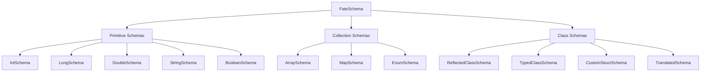

# Schema system

A schema describes how one type becomes bytes. FateWeaver writes the schema into the log ahead of
the data, so a reader can decode the file without knowing anything about your code.

## What are schemas?

Every channel has exactly one schema, and that schema fixes the channel's layout for the life of
the log. It gives you the field names and types a viewer needs, and it makes a type mismatch a
compile error rather than a plot that looks wrong three matches later.

## Schema types overview

FateWeaver provides several categories of schemas:

## Quick links

- **[Collection Schemas](collection-schemas.md)** - Arrays, maps and enums
- **[Schema Registry](registry.md)** - Global schema management and reuse
- **[Selection Guide](guide.md)** - Performance tips and best practices
