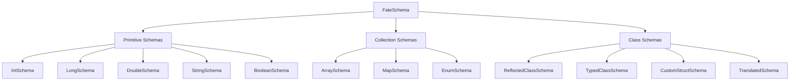

# Schema System

FateWeaver's schema system is the foundation that enables type-safe, efficient serialization of your robot data. Understanding schemas will help you optimize your logging and handle complex data structures effectively.

## What are Schemas?

A **schema** defines how FateWeaver serializes and deserializes objects of a specific type. Each schema:

- Describes the structure of your data
- Provides efficient binary encoding/decoding
- Embeds metadata for compatibility with visualization tools
- Ensures type safety at compile time

## Schema Types Overview

FateWeaver provides several categories of schemas:

## Quick Links

- **[Collection Schemas](collection-schemas.md)** - Arrays, maps and enums
- **[Schema Registry](registry.md)** - Global schema management and reuse
- **[Selection Guide](guide.md)** - Performance tips and best practices
