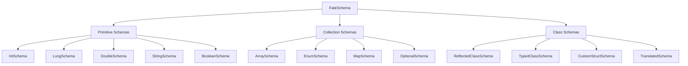

# Schema reference

Every schema type with examples, in one page. See the [schema system overview](index.md) for how
schemas fit together. A schema describes how one type becomes bytes. FateWeaver writes the schema
into the log ahead of the data, so a reader can decode the file without knowing anything about
your code.

## What are schemas?

Every logged path has exactly one schema, and that schema fixes the path's layout until the program
exits. It gives a viewer the field names and types it needs. The first `log` call to a path picks the
schema, and a later value of a different type is skipped with a one-time warning instead of
producing a plot that looks wrong three matches later.

Most of the time you never name a schema. `Fate.log("Battery/Voltage", volts)` infers `DoubleSchema`
from the value. This page covers what inference produces and how to pick a schema yourself.

In Kotlin, import the `log` extension next to `Fate`. The examples below assume both imports:

```kotlin
import gay.zharel.fateweaver.telemetry.Fate
import gay.zharel.fateweaver.telemetry.log
```

To use a schema you built, pass it as a third argument. `Fate.log(name, value, schema)` and
`table.log(name, value, schema)` use that schema and skip inference. The first log to a path fixes
its schema, so pass the same schema on every call.

## Schema types overview

FateWeaver has three categories of schemas:



## Primitive schemas

Five singletons cover the types that need no configuration. Each has a fixed size, so nothing has
to be measured before writing. You rarely pass these yourself, because `log` infers them from an
`Int`, `Long`, `Double`, `String` or `Boolean`.

### IntSchema

Serializes 32-bit signed integers.

=== "Kotlin"

    ```kotlin
    Fate.log("Motors/Encoder/Position", motor.currentPosition)
    ```

=== "Java"

    ```java
    Fate.log("Motors/Encoder/Position", motor.getCurrentPosition());
    ```

### LongSchema

Serializes 64-bit signed integers. Use it for counters and other whole numbers that outgrow an `Int`.
You don't log timestamps yourself, because every message in a version 3 log already carries one, in
nanoseconds.

=== "Kotlin"

    ```kotlin
    Fate.log("Loop/Count", loopCount.toLong())
    ```

=== "Java"

    ```java
    Fate.log("Loop/Count", (long) loopCount);
    ```

### DoubleSchema

Serializes 64-bit floating-point numbers with full precision. `Float` fields and `FloatArray` use
this too, widened on the way out, since the format has no float type. The conversion is exact, but
the encoded value takes 8 bytes instead of 4.

=== "Kotlin"

    ```kotlin
    Fate.log("Battery/Voltage", voltageSensor.voltage)
    ```

=== "Java"

    ```java
    Fate.log("Battery/Voltage", voltageSensor.getVoltage());
    ```

### StringSchema

Serializes UTF-8 strings, each with a length prefix.

=== "Kotlin"

    ```kotlin
    Fate.log("Robot/Status", "Autonomous Active")
    ```

=== "Java"

    ```java
    Fate.log("Robot/Status", "Autonomous Active");
    ```

### BooleanSchema

Serializes booleans as single bytes.

=== "Kotlin"

    ```kotlin
    Fate.log("Sensors/LimitSwitch", limitSwitch.isPressed)
    ```

=== "Java"

    ```java
    Fate.log("Sensors/LimitSwitch", limitSwitch.isPressed());
    ```

## Collection schemas

### ArraySchema<T>

Serializes arrays of any supported type, with a length prefix. Pass the schema explicitly when you
want the boxed form. The Kotlin example logs an `Array<Double>`, and the Java one logs a `Double[]`.

=== "Kotlin"

    ```kotlin
    val motorPowersSchema = ArraySchema(DoubleSchema)

    Fate.log("Motors/Powers", arrayOf(0.8, 0.6, 0.7, 0.9), motorPowersSchema)
    ```

=== "Java"

    ```java
    ArraySchema<Double> motorPowersSchema = new ArraySchema<>(DoubleSchema.INSTANCE);

    Fate.log("Motors/Powers", new Double[]{0.8, 0.6, 0.7, 0.9}, motorPowersSchema);
    ```

!!! tip "Primitive arrays have their own schemas"
    `DoubleArray`, `IntArray`, `LongArray` and `BooleanArray` get `DoubleArraySchema` and the
    matching ones for the other types. They write the same bytes as the boxed form and don't
    allocate. Inference picks them for you, so `Fate.log("Powers", doubleArrayOf(0.8, 0.6))` needs
    no schema argument.

### MapSchema<K, V>

Serializes maps with an entry count prefix. Keys don't have to be strings. Any supported type works.

In Kotlin, `log` keeps the type arguments, so a `Map<String, Double>` is inferred without a schema.
Java's two-argument `log` only sees the runtime class and can't log a map, so Java passes a schema.

=== "Kotlin"

    ```kotlin
    // Inferred from Map<String, Double>
    Fate.log("Motors/Powers", mapOf("fl" to 0.8, "fr" to 0.6))

    // Or with an explicit schema
    val powersSchema = MapSchema(StringSchema, DoubleSchema)
    Fate.log("Motors/Powers", mapOf("fl" to 0.8, "fr" to 0.6), powersSchema)
    ```

=== "Java"

    ```java
    MapSchema<String, Double> powersSchema =
        new MapSchema<>(StringSchema.INSTANCE, DoubleSchema.INSTANCE);

    Map<String, Double> powers = new LinkedHashMap<>();
    powers.put("fl", 0.8);
    powers.put("fr", 0.6);
    Fate.log("Motors/Powers", powers, powersSchema);
    ```

!!! warning "Homogeneous values only"
    The format has a fixed shape, so every value in a map must share one type. `Map<String, Any>`
    can't be logged. FateWeaver rejects it when it builds the schema and warns once. Entry order
    carries no meaning in the log. A nullable value type such as `Map<String, Double?>` is fine and
    infers an `OptionalSchema` for the value.

### EnumSchema<T>

Serializes enums as their ordinal.

=== "Kotlin"

    ```kotlin
    enum class AllianceColor { RED, BLUE }

    // Inferred from the enum class
    Fate.log("Match/Alliance", AllianceColor.RED)

    // Or with an explicit schema
    val allianceSchema = EnumSchema(AllianceColor::class.java)
    Fate.log("Match/Alliance", AllianceColor.RED, allianceSchema)
    ```

=== "Java"

    ```java
    enum AllianceColor { RED, BLUE }

    // Inferred from the enum class
    Fate.log("Match/Alliance", AllianceColor.RED);

    // Or with an explicit schema
    EnumSchema<AllianceColor> allianceSchema = new EnumSchema<>(AllianceColor.class);
    Fate.log("Match/Alliance", AllianceColor.RED, allianceSchema);
    ```

## Class schemas

You have four ways to turn one of your own classes into bytes, from no effort to full control.

### ReflectedClassSchema<T>

Built by reflecting over the class's public properties. This is what you get when you log an
instance of your own class and name no schema.

=== "Kotlin"

    ```kotlin
    data class RobotConfig(
        val maxSpeed: Double,
        val wheelDiameter: Double,
        val trackWidth: Double,
        val gearRatio: Double
    )

    // FateWeaver infers a ReflectedClassSchema from the class
    Fate.log("Robot/Config", RobotConfig(1.0, 4.0, 14.5, 1.5))
    ```

=== "Java"

    ```java
    public class RobotConfig {
        public final double maxSpeed;
        public final double wheelDiameter;
        public final double trackWidth;
        public final double gearRatio;

        public RobotConfig(double maxSpeed, double wheelDiameter,
                          double trackWidth, double gearRatio) {
            this.maxSpeed = maxSpeed;
            this.wheelDiameter = wheelDiameter;
            this.trackWidth = trackWidth;
            this.gearRatio = gearRatio;
        }
    }

    // FateWeaver infers a ReflectedClassSchema from the class
    Fate.log("Robot/Config", new RobotConfig(1.0, 4.0, 14.5, 1.5));
    ```

#### How reflection works

`ReflectedClassSchema` walks the class's public fields, which are public properties in Kotlin, and
builds a schema for each field's type. It does this recursively, so nested classes work. It reads
the declared type of arrays, `List`, `Set` and `Map` fields to infer their element, key and value
schemas.

!!! warning "Limitations"
    - Private fields are skipped, with or without getters. Make them public or use a
      `CustomStructSchema`.
    - Every write reads each field through reflection. A `CustomStructSchema` avoids that cost.
    - Generic fields need concrete type arguments. `Map<String, Any>` and `List<*>` are rejected
      when the schema is built. Nullable arguments like `List<String?>` are fine and infer as
      optional elements.
    - A field must be declared nullable to hold null. A `Foo?` property infers an
      `OptionalSchema`. A non-null property that turns out to be null fails the write, and the
      warning names the field.

### TypedClassSchema<T>

A version of `ReflectedClassSchema` that also writes a type name into the log. You turn it on with
an `AS_TYPE` static field in Java, or a companion object property in Kotlin.

=== "Kotlin"

    ```kotlin
    data class SensorReading(
        val timestamp: Long,
        val value: Double,
        val sensorId: String
    ) {
        companion object {
            const val AS_TYPE = "SensorReading"  // Triggers TypedClassSchema
        }
    }

    // Uses TypedClassSchema because of AS_TYPE
    Fate.log("Sensors/Reading", SensorReading(System.nanoTime(), 3.2, "left"))
    ```

=== "Java"

    ```java
    public class SensorReading {
        public static final String AS_TYPE = "SensorReading";  // Triggers TypedClassSchema

        public final long timestamp;
        public final double value;
        public final String sensorId;

        public SensorReading(long timestamp, double value, String sensorId) {
            this.timestamp = timestamp;
            this.value = value;
            this.sensorId = sensorId;
        }
    }

    // Uses TypedClassSchema because of AS_TYPE
    Fate.log("Sensors/Reading", new SensorReading(System.nanoTime(), 3.2, "left"));
    ```

#### Why use AS_TYPE

The name goes into the log next to the fields. A viewer or an analysis script can then tell a
`Pose2d` from any other three-double struct without matching on the path.

### CustomStructSchema<T>

You name the components and supply a function that pulls them out of the object. Nothing is
reflected, and nothing is written that you didn't ask for. Pass the schema on every log call.

=== "Kotlin"

    ```kotlin
    data class Pose2d(val x: Double, val y: Double, val heading: Double)

    val customPoseSchema = CustomStructSchema<Pose2d>(
        type = "Pose2d",
        componentNames = listOf("x", "y", "heading"),
        componentSchemas = listOf(DoubleSchema, DoubleSchema, DoubleSchema),
        encoder = { pose ->
            listOf(pose.x, pose.y, pose.heading)
        }
    )

    Fate.log("Robot/Pose", pose, customPoseSchema)
    ```

=== "Java"

    ```java
    public class Pose2d {
        public final double x, y, heading;

        public Pose2d(double x, double y, double heading) {
            this.x = x; this.y = y; this.heading = heading;
        }
    }

    CustomStructSchema<Pose2d> customPoseSchema = new CustomStructSchema<>(
        "Pose2d",
        Arrays.asList("x", "y", "heading"),
        Arrays.asList(DoubleSchema.INSTANCE, DoubleSchema.INSTANCE, DoubleSchema.INSTANCE),
        pose -> Arrays.asList(pose.x, pose.y, pose.heading)
    );

    Fate.log("Robot/Pose", pose, customPoseSchema);
    ```

#### Advanced custom schema examples

##### Data transformation

=== "Kotlin"

    ```kotlin
    // Convert units during serialization
    val distanceSchema = CustomStructSchema<Double>(
        type = "Distance",
        componentNames = listOf("meters"),
        componentSchemas = listOf(DoubleSchema),
        encoder = { inches -> listOf(inches * 0.0254) }  // Convert inches to meters
    )

    Fate.log("Drive/Distance", distanceInches, distanceSchema)
    ```

=== "Java"

    ```java
    // Convert units during serialization
    CustomStructSchema<Double> distanceSchema = new CustomStructSchema<>(
        "Distance",
        Arrays.asList("meters"),
        Arrays.asList(DoubleSchema.INSTANCE),
        inches -> Arrays.asList(inches * 0.0254)  // Convert inches to meters
    );

    Fate.log("Drive/Distance", distanceInches, distanceSchema);
    ```

##### Selective field logging

=== "Kotlin"

    ```kotlin
    data class ComplexObject(
        val importantData: Double,
        val timestamp: Long,
        val debugInfo: String,      // Skip this
        val internalState: Any      // Skip this
    )

    val selectiveSchema = CustomStructSchema<ComplexObject>(
        type = "ImportantData",
        componentNames = listOf("data", "time"),
        componentSchemas = listOf(DoubleSchema, LongSchema),
        encoder = { obj ->
            listOf(obj.importantData, obj.timestamp)  // Only log important fields
        }
    )

    Fate.log("Robot/Important", complexObject, selectiveSchema)
    ```

=== "Java"

    ```java
    CustomStructSchema<ComplexObject> selectiveSchema = new CustomStructSchema<>(
        "ImportantData",
        Arrays.asList("data", "time"),
        Arrays.asList(DoubleSchema.INSTANCE, LongSchema.INSTANCE),
        obj -> Arrays.asList(obj.importantData, obj.timestamp)  // Only log important fields
    );

    Fate.log("Robot/Important", complexObject, selectiveSchema);
    ```

### TranslatedSchema<T, U>

Converts a value to another type on the way out, then encodes that. You give it a function from
`T` to `U` and a schema for `U`.

Use it for a class you can't modify, from RoadRunner or any other library, and for wrappers you
would rather see unwrapped in the log. A `Rotation2d` becomes a plain double, so the plot shows a
heading in radians instead of a one-field struct.

#### Basic usage

=== "Kotlin"

    ```kotlin
    // You have a wrapper class but want to log the inner value
    data class Voltage(val value: Double)

    val voltageSchema = TranslatedSchema<Voltage, Double>(
        baseSchema = DoubleSchema,
        toBase = { voltage -> voltage.value }
    )

    Fate.log("Battery/Voltage", Voltage(12.6), voltageSchema)  // Logs as 12.6 (double)
    ```

=== "Java"

    ```java
    // You have a wrapper class but want to log the inner value
    public class Voltage {
        public final double value;
        public Voltage(double value) { this.value = value; }
    }

    TranslatedSchema<Voltage, Double> voltageSchema = new TranslatedSchema<>(
        DoubleSchema.INSTANCE,
        voltage -> voltage.value
    );

    Fate.log("Battery/Voltage", new Voltage(12.6), voltageSchema);  // Logs as 12.6 (double)
    ```

#### Alternative constructor

You can also pass the target class and let FateWeaver look up its schema:

=== "Kotlin"

    ```kotlin
    val voltageSchema = TranslatedSchema<Voltage, Double>(
        baseClass = Double::class.java,
        toBase = { voltage -> voltage.value }
    )
    // FateWeaver finds or creates the schema for Double
    ```

=== "Java"

    ```java
    TranslatedSchema<Voltage, Double> voltageSchema = new TranslatedSchema<>(
        Double.class,
        voltage -> voltage.value
    );
    // FateWeaver finds or creates the schema for Double
    ```

#### Advanced examples

##### Converting library types

=== "Kotlin"

    ```kotlin
    // RoadRunner's Rotation2d to Double
    import com.acmerobotics.roadrunner.Rotation2d

    val rotationSchema = TranslatedSchema<Rotation2d, Double>(
        baseClass = Double::class.java,
        toBase = { rotation -> rotation.toDouble() }
    )

    Fate.log("Robot/Heading", Rotation2d.exp(Math.PI / 2), rotationSchema)  // Logs as 1.5707... (double)
    ```

=== "Java"

    ```java
    // RoadRunner's Rotation2d to Double
    import com.acmerobotics.roadrunner.Rotation2d;

    TranslatedSchema<Rotation2d, Double> rotationSchema = new TranslatedSchema<>(
        Double.class,
        rotation -> rotation.toDouble()
    );

    Fate.log("Robot/Heading", Rotation2d.exp(Math.PI / 2), rotationSchema);  // Logs as 1.5707... (double)
    ```

##### Converting to complex types

=== "Kotlin"

    ```kotlin
    // Convert a custom type to a data class with a registered schema
    data class MotorState(val power: Double, val position: Int, val velocity: Double)

    class Motor(/* ... */) {
        fun getPower(): Double = /* ... */
        fun getPosition(): Int = /* ... */
        fun getVelocity(): Double = /* ... */
    }

    val motorSchema = TranslatedSchema<Motor, MotorState>(
        baseClass = MotorState::class.java,
        toBase = { motor ->
            MotorState(motor.getPower(), motor.getPosition(), motor.getVelocity())
        }
    )

    Fate.log("Motors/FrontLeft", frontLeftMotor, motorSchema)  // Converted to MotorState, then serialized
    ```

=== "Java"

    ```java
    // Convert a custom type to a data class with a registered schema
    public class MotorState {
        public final double power;
        public final int position;
        public final double velocity;

        public MotorState(double power, int position, double velocity) {
            this.power = power;
            this.position = position;
            this.velocity = velocity;
        }
    }

    public class Motor {
        public double getPower() { /* ... */ }
        public int getPosition() { /* ... */ }
        public double getVelocity() { /* ... */ }
    }

    TranslatedSchema<Motor, MotorState> motorSchema = new TranslatedSchema<>(
        MotorState.class,
        motor -> new MotorState(motor.getPower(), motor.getPosition(), motor.getVelocity())
    );

    Fate.log("Motors/FrontLeft", frontLeftMotor, motorSchema);  // Converted to MotorState, then serialized
    ```

##### Enum to string conversion

=== "Kotlin"

    ```kotlin
    enum class DriveMode { FIELD_CENTRIC, ROBOT_CENTRIC, AUTO }

    val driveModeSchema = TranslatedSchema<DriveMode, String>(
        baseClass = String::class.java,
        toBase = { mode -> mode.name }
    )

    Fate.log("Drive/Mode", DriveMode.FIELD_CENTRIC, driveModeSchema)  // Logs as "FIELD_CENTRIC" (string)
    ```

=== "Java"

    ```java
    enum DriveMode { FIELD_CENTRIC, ROBOT_CENTRIC, AUTO }

    TranslatedSchema<DriveMode, String> driveModeSchema = new TranslatedSchema<>(
        String.class,
        mode -> mode.name()
    );

    Fate.log("Drive/Mode", DriveMode.FIELD_CENTRIC, driveModeSchema);  // Logs as "FIELD_CENTRIC" (string)
    ```

#### When to use TranslatedSchema

| Situation                      | Use TranslatedSchema? | Alternative                           |
|--------------------------------|-----------------------|---------------------------------------|
| Wrapper class with one value   | Yes                   | CustomStructSchema                    |
| Library type you can't modify  | Yes                   | CustomStructSchema                    |
| Converting to an existing type | Yes                   | CustomStructSchema for a custom shape |
| Multi-field conversion         | Maybe                 | CustomStructSchema                    |
| Unwrapping a simple type       | Yes                   | Read the field directly               |

#### Performance considerations

The translation function runs on every logged value, twice. Once sizes the output and once encodes
it. The base schema is built once and reused, so nothing is reflected per write. Keep the function
to field reads and arithmetic. If you log the value every loop, don't allocate a temporary object
in it.

!!! tip "Combining with the schema registry"
    You can register a `TranslatedSchema` globally so plain `log` calls use it:

    ```kotlin
    FateSchema.registerSchema(Voltage::class.java, voltageSchema)

    // Plain log now uses the translation for every Voltage
    Fate.log("Battery/Voltage", Voltage(12.6))
    ```

## Schema registry

The registry maps a class to the schema used for it everywhere. See the
[registry page](registry.md) for more.

### Automatic registration

When you log a value of a class that has no schema yet, FateWeaver does four things:

1. Checks whether a schema is registered for that class.
2. If not, builds one by reflection, a `TypedClassSchema` if the class has `AS_TYPE` and a
   `ReflectedClassSchema` otherwise.
3. Registers that schema for later use.
4. Creates the path with the registered schema.

### Manual registration

Register your own schema to replace the default. After that, plain `log(name, value)` uses it, so
you don't pass the schema on each call.

=== "Kotlin"

    ```kotlin
    // Define once
    val optimizedPoseSchema = CustomStructSchema<Pose2d>(
        type = "Pose2d",
        componentNames = listOf("x", "y", "theta"),
        componentSchemas = listOf(DoubleSchema, DoubleSchema, DoubleSchema),
        encoder = { pose -> listOf(pose.position.x, pose.position.y, pose.heading.toDouble()) }
    )

    // Register globally
    FateSchema.registerSchema(Pose2d::class.java, optimizedPoseSchema)

    // Every later log of a Pose2d uses your schema
    Fate.log("Robot/Pose", pose)
    Fate.log("Target/Pose", targetPose)
    ```

=== "Java"

    ```java
    // Define once
    CustomStructSchema<Pose2d> optimizedPoseSchema = new CustomStructSchema<>(
        "Pose2d",
        Arrays.asList("x", "y", "theta"),
        Arrays.asList(DoubleSchema.INSTANCE, DoubleSchema.INSTANCE, DoubleSchema.INSTANCE),
        pose -> Arrays.asList(pose.position.x, pose.position.y, pose.heading.toDouble())
    );

    // Register globally
    FateSchema.registerSchema(Pose2d.class, optimizedPoseSchema);

    // Every later log of a Pose2d uses your schema
    Fate.log("Robot/Pose", pose);
    Fate.log("Target/Pose", targetPose);
    ```

### Where to register

Register in your OpMode's `init()`, before anything logs a value of that class. A path keeps the
schema it got on its first log, so a schema registered afterward does nothing for paths that
already exist.

Keep every registration in one place. Registering the same class twice overwrites the first
registration without a warning, and the calls are easy to compare when they sit next to each other.

=== "Kotlin"

    ```kotlin
    abstract class BaseOpMode : OpMode() {
        override fun init() {
            setupSchemas()
            initHardware()
        }

        private fun setupSchemas() {
            // Register all custom schemas here
            FateSchema.registerSchema(Pose2d::class.java, OPTIMIZED_POSE_SCHEMA)
            FateSchema.registerSchema(PoseVelocity2d::class.java, VELOCITY_SCHEMA)
            FateSchema.registerSchema(RobotState::class.java, STATE_SCHEMA)
        }

        companion object {
            private val OPTIMIZED_POSE_SCHEMA = CustomStructSchema<Pose2d>(/* ... */)
            private val VELOCITY_SCHEMA = CustomStructSchema<PoseVelocity2d>(/* ... */)
            private val STATE_SCHEMA = CustomStructSchema<RobotState>(/* ... */)
        }
    }
    ```

=== "Java"

    ```java
    public abstract class BaseOpMode extends OpMode {
        @Override
        public final void init() {
            setupSchemas();
            initHardware();
        }

        private void setupSchemas() {
            // Register all custom schemas here
            FateSchema.registerSchema(Pose2d.class, OPTIMIZED_POSE_SCHEMA);
            FateSchema.registerSchema(PoseVelocity2d.class, VELOCITY_SCHEMA);
            FateSchema.registerSchema(RobotState.class, STATE_SCHEMA);
        }

        protected abstract void initHardware();

        private static final CustomStructSchema<Pose2d> OPTIMIZED_POSE_SCHEMA =
            new CustomStructSchema<>(/* ... */);
        private static final CustomStructSchema<PoseVelocity2d> VELOCITY_SCHEMA =
            new CustomStructSchema<>(/* ... */);
        private static final CustomStructSchema<RobotState> STATE_SCHEMA =
            new CustomStructSchema<>(/* ... */);
    }
    ```

## Schema selection guide

Pick the schema from what you are logging:

| What you log                        | Schema                     | Why                                   |
|-------------------------------------|----------------------------|---------------------------------------|
| Simple values (int, double, string) | Primitive schemas          | Inferred, fixed size                  |
| Arrays                              | ArraySchema                | Inferred, length prefix               |
| Lists and sets                      | ArraySchema (inferred)     | Same bytes as an array                |
| Maps with one value type            | MapSchema                  | Inferred in Kotlin, explicit in Java  |
| Enums                               | EnumSchema                 | Stored as a 4-byte ordinal            |
| Simple data classes                 | ReflectedClassSchema       | Inferred, no setup                    |
| Classes a viewer should recognize   | TypedClassSchema (AS_TYPE) | Writes the type name into the log     |
| Hot paths                           | CustomStructSchema         | No reflection on each write           |
| Unit conversion                     | CustomStructSchema         | Converts in the encoder               |
| Logging only some fields            | CustomStructSchema         | You choose which fields to write      |

## Troubleshooting schemas

FateWeaver never throws into your robot code. When it can't build a schema or log a value, it
warns once and skips the value. These are the usual causes.

### Common issues

**"Could not log ...: no schema for ..."**
```kotlin
// Problem: the class has no public fields
data class PrivateFields(private val x: Int)

// Solution: use CustomStructSchema or make the fields public
data class PublicFields(val x: Int)
```

**Unsupported field type**
```kotlin
// Problem: functions have no schema
data class BadClass(val lambda: () -> Unit)

// Solution: use supported types or a CustomStructSchema
data class GoodClass(val value: Double)
```

**A value is skipped with "A path keeps one type"**
```kotlin
// Problem: the first log fixed "Arm/Target" as a Double
Fate.log("Arm/Target", 0.5)
Fate.log("Arm/Target", "extended")  // skipped, warns once

// Solution: use one type per path, or a different name
Fate.log("Arm/State", "extended")
```

**Paths using the wrong schema**
```kotlin
// Problem: registering twice. The second call overwrites the first without
// a warning, and paths that already logged keep the old schema.
FateSchema.registerSchema(MyClass::class.java, schemaV1)
// Later...
FateSchema.registerSchema(MyClass::class.java, schemaV2)

// Solution: register each schema once, before anything logs that class
```
